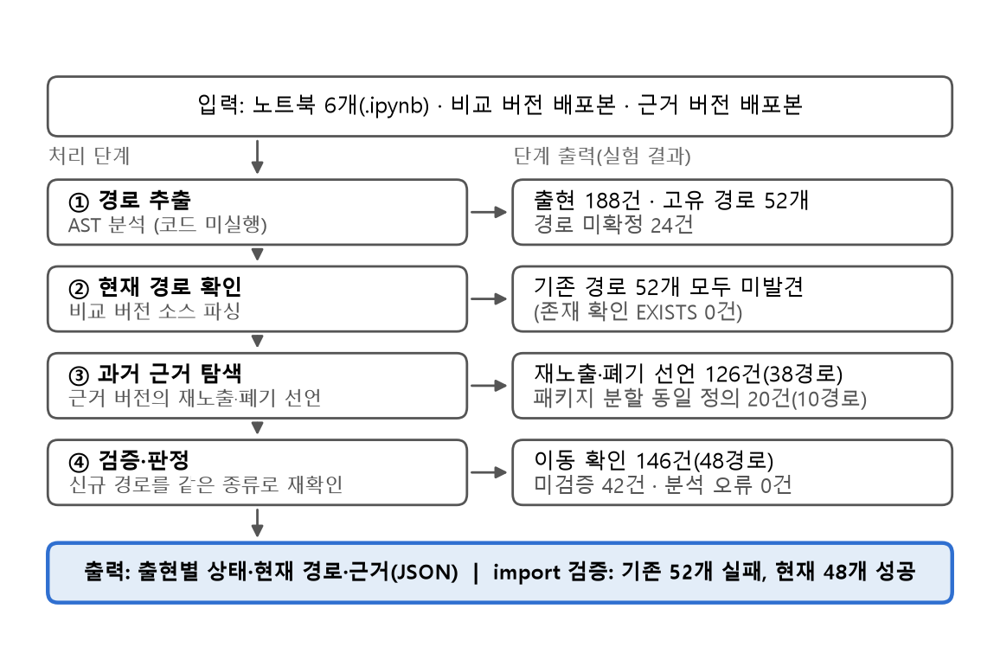

## 요 약

과거에 작성된 코드는 패키지가 갱신되면 가져오기(import) 경로가 바뀌어 실행되지 않을 수 있다. 본 연구는 **어떤 API 경로가 오래되었는지 찾고, 현재 어떤 경로로 바뀌었는지 근거와 함께 제공**한다. LangChain 강좌의 주피터 노트북(Jupyter Notebook) 6개를 코드 실행 없이 추상 구문 트리(Abstract Syntax Tree, AST)로 분석해 API 경로를 추출하고, PyPI 배포본 소스에서 현재 경로를 확인한 뒤, 과거 배포본에서 기존 경로와 새 경로를 잇는 근거가 있을 때만 이동 확인(MOVED)으로 판정한다. 188건의 API 출현(고유 경로 52개) 중 146건(48개)에서 현재 경로를 찾았고 42건은 미검증(UNVERIFIED)으로 남았다. 비교 버전을 설치해 직접 가져오기를 실행한 결과 기존 경로 52개는 모두 실패하고 제시한 현재 경로 48개는 모두 성공했다. 추출 단계는 노트북 1개(L4)만 정답표와 비교해 정밀도 0.878, 재현율 0.878을 얻었고 나머지 5개는 평가하지 못했으며, 동작 호환성은 보증하지 않는다.

## 1. 서 론

LangChain처럼 갱신이 잦고 기능을 여러 패키지로 나누어 배포하는 라이브러리는, 과거 코드나 인공지능이 생성한 코드에서 같은 클래스라도 가져오기(import) 경로가 달라져 최신 환경에서 오류가 난다. 개발자에게 필요한 정보는 "어떤 API가 오래되었는가"와 "현재는 어떤 경로를 써야 하는가"이다.

본 연구의 목적은 오래된 코드의 패키지·API를 분석하여 **오래된 API를 찾고 현재 어떤 API로 바뀌었는지 정보를 근거와 함께 제공**하는 것이다. 구현·검증한 범위는 경로 추출, 현재 배포본에서의 경로 확인, 과거 배포본 소스에 근거한 이동 확인까지이다. 코드 자동 수정, 매개변수 호환성 검증, 버전별 API 이력 데이터베이스는 구현하지 않았다.

기여는 네 가지이다. (1) 노트북 6개에서 188건의 API 출현을 코드 실행 없이 추출했다. (2) "최신에서 찾지 못함"과 "이동이 확인됨"을 구분하는 판정 기준을 구현했다. (3) 실험으로 고유 경로 52개 중 48개(146건)의 현재 경로를 파일·줄·버전 근거와 함께 확인했다. (4) 비교 버전을 설치해 가져오기를 실제로 실행해, 기존 경로 52개가 모두 실패하고 제시한 경로 48개가 모두 성공함을 확인했다.

2장은 관련 연구와 용어, 3장은 제안 방법, 4장은 실험 결과, 5장은 결론 및 향후 연구이다.

## 2. 관련 연구 및 용어 정의

**2.1 관련 연구.** 한 연구는 Python 라이브러리의 폐기 예정(deprecated) API 처리가 미흡함을 6개 라이브러리와 1,200개 프로젝트로 보였다[1]. 다른 연구는 신·구 API 쌍이 주어졌을 때 사용 코드를 갱신하는 규칙을 추론한다[2]. FreshDoc은 Java 라이브러리의 개정 이력(Git)에서 이름 변경·이동 규칙을 추출해 문서의 오래된 API 이름을 찾는다[3]. 이들은 안내 문서, 개정 이력, 또는 이미 주어진 신·구 쌍에 의존한다는 한계가 있다. 본 연구는 PyPI 배포본만으로 코드에서 경로를 추출하고, 그 쌍이 실제로 존재한다는 근거를 확인한다.

한편 패키지 이름이 PyPI에 등록되어 있는지 확인하는 방법은 패키지 단위 검사이다. 패키지가 존재해도 그 안의 모듈·클래스·메서드 경로는 버전마다 달라지므로, **패키지 등록 여부만으로는 API의 유효성을 판단할 수 없다.** 예컨대 `langchain`은 PyPI에 존재하지만 `langchain.document_loaders.PyPDFLoader` 경로는 최신 배포본에서 확인되지 않는다(4장).

**2.2 용어와 대상.** 패키지 이름(package name)은 PyPI에 배포되는 단위의 이름이다(예: `langchain-community`). API 경로(API path)는 패키지 안의 모듈·클래스·함수·메서드를 점으로 이은 완전 수식 이름이다(예: `langchain.document_loaders.PyPDFLoader`). 주피터 노트북(Jupyter Notebook)은 코드 셀과 설명 셀로 이루어진 `.ipynb` 문서이다. 출현(occurrence)은 경로가 추출된 코드 위치 하나이고, 고유 경로(unique path)는 같은 문자열을 하나로 센 것이다. 비교 버전(comparison version)은 현재 경로를 확인하는 최신 배포본이고, 근거 버전(evidence version, `langchain 0.3.27`)은 기존→신규 관계의 증거를 읽는 과거 배포본이다.

분석 대상 L1~L6은 DeepLearning.AI 강좌 "LangChain: Chat with Your Data"의 노트북 6개(L1 Document loading, L2 Document splitting, L3 Vectorstores and Embeddings, L4 Retrieval, L5 Question answering, L6 Chat)의 약칭이다. 공개 저장소 `github.com/ksm26/LangChain-Chat-with-Your-Data`[6]의 노트북과 코드 셀 내용이 같다. 분석 코드와 결과는 `github.com/seohyeonban/LangChain-Chat-with-Your-Data`(`main` 브랜치)[5]에 공개한다.

## 3. 제안 방법

**3.1 전체 개요.** 그림 1은 입력에서 최종 출력까지의 흐름이다. 단계는 구현 구조(`api_migration_analyzer_v2.py`)에 따라 나누었고, 표 1은 단계마다 무엇을 입력받아 어떤 처리를 해 무엇을 출력하는지, 왜 나뉘는지 정리한 것이다.

{width=100%}

표 1. 단계별 입력·처리·출력과 분리 이유

| 단계 | 입력 | 처리 | 출력 | 분리 이유 |
|---|---|---|---|---|
| ① 경로 추출 | 노트북의 코드 셀 | AST로 가져오기(import) 별칭·지역 변수를 추적(코드 미실행) | 출현 위치와 API 경로(또는 경로 미확정) | 이후 단계는 경로 문자열만 필요 |
| ② 현재 경로 확인 | API 경로, 비교 배포본 | 비교 버전 소스를 파싱해 정의·재노출·상속 해석 | 존재 확인(EXISTS) / 미발견 / 오류 | 존재하면 변경 분석이 불필요 |
| ③ 과거 근거 탐색 | 미발견 경로, 근거 배포본 | 과거 소스의 재노출·폐기 선언 관계 탐색 | 기존→신규 관계와 파일·줄 근거 | "못 찾음"만으로는 이동·삭제를 구분하지 못함 |
| ④ 검증·판정 | 기존→신규 관계, 비교 배포본 | 신규 경로를 같은 종류로 재확인, 패키지 분할 규칙 적용 | 이동 확인(MOVED) / 미검증(UNVERIFIED) / 분석 오류(ANALYSIS_ERROR) | 확인된 것만 확정하고 나머지는 보류 |

**3.2 판정 기준과 설정.** 이동 확인(MOVED)은 (a) 과거 공식 소스의 재노출·폐기 선언이 신규 경로로 이어지고 그 경로가 비교 버전에서 같은 종류로 확인되거나, (b) `langchain.X`와 `langchain_classic.X`의 정의가 정규화한 AST로 동일할 때 부여한다. (b)는 약한 근거이므로 따로 기록한다. 근거가 없으면 미검증(UNVERIFIED), 다운로드·파싱 실패는 분석 오류(ANALYSIS_ERROR)로 둔다. 이름만 같은 후보는 목록에만 두고 새 경로로 채택하지 않는다. 이렇게 한 이유는 "최신에서 못 찾음"이 이동·삭제·분석 실패를 구별하지 못하고, 이름이 비슷한 후보는 잘못된 경로를 낳기 때문이다. **문자열 유사도 임계값은 사용하지 않는다**(패키지 이름 검사 도구의 유사도 임계값 0.55는 본 실험에 쓰지 않았다).

## 4. 실험 결과

**4.1 실험 설정.** 비교 버전은 langchain 1.3.13, langchain-community 0.4.2, langchain-core 1.6.9, langchain-text-splitters 1.1.3, langchain-openai 1.7.0, langchain-classic 1.0.8이고, 근거 버전은 langchain 0.3.27(보조: community 0.3.27, core 0.3.72, text-splitters 0.3.9)이며 모두 PyPI 공식 배포본이다[4]. Python 3.12.10으로 2026-10-11에 분석했다. 같은 명령을 다시 실행해 188행의 결과가 일치함을 확인했다.

**4.2 정량 결과.** 표 2는 분석 대상 수와 상태별 결과이다. 분석 대상은 출현 188건(고유 경로 52개)이고, 오래된 API는 이동이 확인된 기존 경로 고유 48개(146건), 변경 정보(현재 경로)를 찾은 것도 48개이다. 근거 유형은 공식 재노출·폐기 선언 38개(126건), 패키지 분할 동일 정의 10개(20건)이다. 이는 경로 근거이며 코드를 수정했다는 뜻이 아니다. 또한 이전 버전 분석기가 출력한 `OUTDATED`는 "최신 소스에서 같은 경로를 못 찾음"만을 뜻해 이동 확인과 다르다.

표 2. 상태별 결과 (출현 = 코드 위치, 고유 = 경로 중복 제거)

| 구분 | 분석 대상 | 이동 확인(MOVED) | 미검증(UNVERIFIED) | 존재 확인(EXISTS) | 분석 오류 |
|---|---:|---:|---:|---:|---:|
| 출현 | 188 | 146 | 42 | 0 | 0 |
| 고유 경로 | 52 | 48 | 4 | 0 | 0 |

미검증 42건은 근거 부족 경로 4개의 18건과 변수 객체의 타입을 추론하지 못해 경로가 없는 24건이다. 노트북별 이동 확인은 L1 16, L2 40, L3 15, L4 30, L5 14, L6 31건이다.

**4.3 변경 사례.** 표 3은 기존 API 경로가 분석을 거쳤을 때 어떤 결과와 현재 경로로 이어지는지 보인다. 예를 들어 `from langchain.document_loaders import PyPDFLoader`는 현재 `langchain_community.document_loaders`에서 가져와야 함을 근거와 함께 알려 준다.

표 3. 기존 API 경로 → 분석 결과 → 현재 API 경로

| 기존 API 경로 (출현) | 분석 결과 | 현재 API 경로 |
|---|---|---|
| `langchain.document_loaders.PyPDFLoader` (13) | 이동 확인(공식 폐기 선언) | `langchain_community.document_loaders.PyPDFLoader` |
| `langchain.text_splitter.RecursiveCharacterTextSplitter` (11) | 이동 확인(공식 재노출) | `langchain_text_splitters.RecursiveCharacterTextSplitter` |
| `langchain.vectorstores.Chroma` (7) | 이동 확인(공식 폐기 선언) | `langchain_community.vectorstores.Chroma` |
| `langchain.chains.ConversationalRetrievalChain` (2) | 이동 확인(패키지 분할) | `langchain_classic.chains.ConversationalRetrievalChain` |
| `langchain.chat_models.ChatOpenAI` (6) | 미검증(근거 없음) | (확정 없음) |

**4.4 실행 검증.** 비교 버전을 새 가상환경에 설치하고 경로를 실제로 가져오기해 보았다. 기존 경로 52개는 모두 실패(`AttributeError`)했고 제시한 현재 경로 48개는 모두 성공했다. 실제로 깨진 경로 52개 중 현재 경로를 제시한 비율은 92.3%(48/52, 출현 기준 146/188)이다. 이는 가져오기 가능 여부만 확인하며 동작 동일성을 보증하지 않는다. 입력 경로가 모두 깨져 있어 정상 경로를 잘못 판정하는 오탐은 측정할 수 없다. 상세 사례의 근거 파일·줄과 실행 명령은 저장소 부록(`eval/APPENDIX.md`)[5]에 둔다.

**4.5 평가 기준별 점검.** 고유 경로 52개를 10개 기준으로 점검해 표 4에 정리했다. 기준 5(기능적 동등성)와 6(Git 변경 이력)은 구현하지 않아 "미확인"이고, 나머지는 분석기 결과와 가져오기 실행 결과로 계산했다. 기준 10은 재노출 확인(7)과 가져오기 성공(9)이 모두 있으면 "확정", 패키지 분할로 소스 동일성만 있으면 "검토 필요", 현재 경로가 없으면 "부적합"으로 둔 규칙 값이며 "확정"은 동작이 같다는 뜻이 아니다. 경로별 표는 저장소(`eval/api_criteria_10.csv`)에 둔다.

표 4. 평가 기준별 결과(고유 경로 52개)

| 기준 | 결과(경로 수) | 계산 방식 |
|---|---|---|
| 1 API 존재 | 존재 48, 후보 없음 4 | 소스 확인 |
| 2 경로 일치 | 정확 48 | 소스 확인 |
| 3 이름 일치 | 일치 48 | 문자열 비교 |
| 4 클래스 소속 | 메서드 24개 모두 일치 | 문자열 비교 |
| 5 기능적 동등성 | 미확인 52 | 미구현 |
| 6 Git 변경 이력 | 미확인 52 | 미구현 |
| 7 재노출(REEXPORT) | 확인 38, 미확인 14 | 공식 선언 |
| 8 상속 | 확인 8, 미확인 44 | 소스 확인 |
| 9 실행 가능 | 성공 48, 미검증 4 | 가져오기 실행 |
| 10 정답 신뢰도 | 확정 38, 검토 필요 10, 부적합 4 | 규칙 계산 |

**4.6 추출 정확도(L4).** 노트북 L4(코드 106줄)의 API 출현 41건에 대해 정답표를 분석기 출력 파일을 열지 않고 작성해 줄 단위로 비교했다. `?` 포함 전체는 TP 36, FP 5, FN 5로 정밀도·재현율이 모두 0.878이고, 경로가 확정된 항목만 보면 TP 35, FP 0, FN 5로 정밀도 1.000, 재현율 0.875이다. 불일치 5건은 모두 `from_texts`·`from_llm`이 돌려준 객체의 메서드 호출(예: `smalldb.similarity_search`)로, 정답표는 반환 객체의 클래스를 지정했고 분석기는 `?`로 두었다. 이 5건을 `?`가 맞다고 정하면 41/41이므로 값은 작성 기준에 민감하다. L4 한 개, 단일 작성자의 정답표라 일반화할 수 없다. 정답표는 저장소(`eval/labeling_sheet_L4_filled.csv`)[5]에 둔다.

## 5. 논의 및 결론

**결론.** 본 연구는 오래된 코드에서 "무엇이 오래되었는지"와 "현재 어떤 API로 바뀌었는지"를 알 수 없다는 문제에서 출발했다. 패키지 이름이 PyPI에 등록되어 있는지만으로는 이 정보를 얻을 수 없으므로, 노트북 6개에서 API 경로를 추출하고 배포본 소스의 근거로 현재 경로를 확인했다. 그 결과 첫째, 188건 중 146건(77.7%, 고유 경로 52개 중 48개)에서 기존 경로와 현재 경로를 파일·줄·버전 근거와 함께 제시했다. 둘째, 가져오기 실행으로 기존 경로 52개가 모두 실패하고 제시한 현재 경로 48개가 모두 성공함을 확인했다. 셋째, "최신에서 못 찾음"과 "이동이 확인됨"을 구분하여 이름만 비슷한 잘못된 대체 경로를 채택하지 않았다.

**한계.** (1) 경로 추출의 정밀도·재현율은 L4 한 개 노트북에서만 단일 작성자의 정답표와 비교했고 나머지 5개는 평가하지 못했다. (2) 이동 확인은 경로 관계의 증거이며 매개변수·동작 호환성은 확인하지 않았고, 패키지 분할 10개 경로는 소스 동일성에 근거한다. (3) `RetrievalQA` 클래스는 이동 확인인데 메서드 `from_chain_type`은 미검증이어서 누락 가능성이 있다. (4) 변수 객체의 메서드 호출 24건은 타입 추론 한계로 경로가 없다. (5) 근거 버전이 하나이고 대상이 한 강좌의 노트북 6개이므로 일반화할 수 없다.

**향후 계획.** 각 한계에 대응하여 다음을 수행할 계획이다. (1) 나머지 노트북 5개의 정답표를 만들고 작성자 간 일치율을 확인해 경로 추출의 정밀도·재현율을 평가한다. (2) 근거 부족 4개 경로(18건)에 대해 여러 버전에 걸친 API 이력 데이터베이스를 구축해 근거를 보강할 수 있는지 검증한다. 이 데이터베이스는 현재 구현·실험에 포함되지 않았다. (3) 반환 타입 추론을 확대해 경로가 없는 24건을 줄인다. (4) 매개변수 호환성을 검증한다. (5) 다른 강좌·라이브러리로 대상을 넓혀 일반화 가능성을 확인한다.

## 참고문헌

[1] "Exploring How Deprecated Python Library APIs Are (Not) Handled," in Proc. ESEC/FSE 2020, DOI: 10.1145/3368089.3409735.

[2] "Characterization and Automatic Update of Deprecated Machine-Learning API Usages," arXiv:2011.04962.

[3] "Automatic Detection and Update Suggestion for Outdated API Names in Documentation," IEEE Trans. Softw. Eng., vol. 47, no. 4, pp. 653-675, 2021, DOI: 10.1109/TSE.2019.2901459.

[4] Python Package Index, release files of the langchain packages, https://pypi.org/.

[5] "API path analyzer, results and appendix," GitHub repository (main), https://github.com/seohyeonban/LangChain-Chat-with-Your-Data.

[6] "Course notebooks," GitHub repository, https://github.com/ksm26/LangChain-Chat-with-Your-Data.
